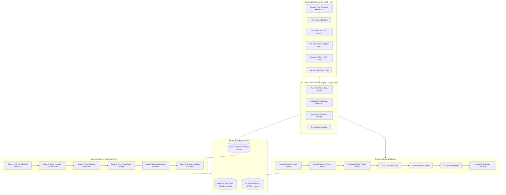
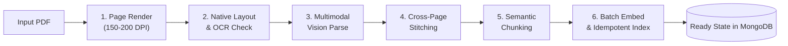
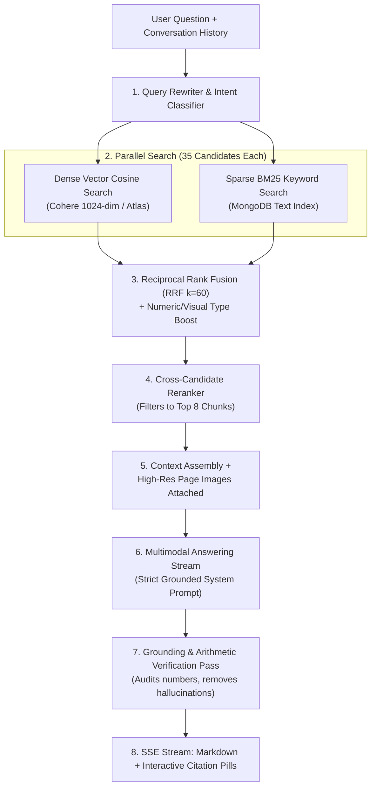
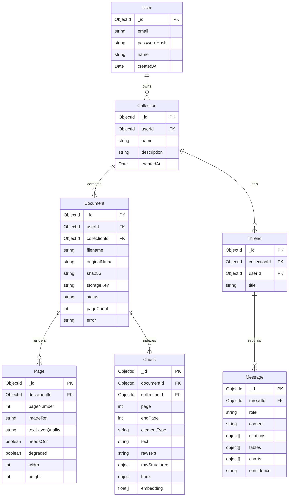
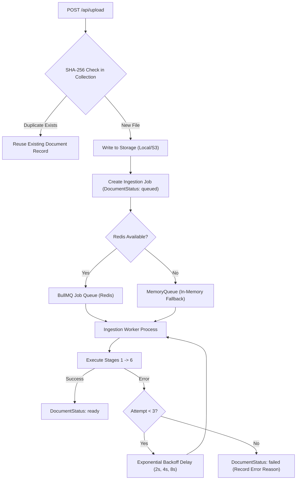

# FolioQ System Architecture & Engineering Blueprint

> **Core System Invariant:**  
> *"Every PDF is parsed faithfully, and every answer is correct, grounded in the documents, and cites its source page."*

---

## Table of Contents
1. [Executive Architectural Blueprint](#1-executive-architectural-blueprint)
2. [End-to-End System Architecture](#2-end-to-end-system-architecture)
3. [The 6-Stage Multi-Modal Ingestion Pipeline](#3-the-6-stage-multi-modal-ingestion-pipeline)
4. [Hybrid Retrieval & Grounded Answering Engine](#4-hybrid-retrieval--grounded-answering-engine)
5. [Data Architecture & Schemas](#5-data-architecture--schemas)
6. [Queue Architecture, Concurrency & Fault Tolerance](#6-queue-architecture-concurrency--fault-tolerance)
7. [Frontend Architecture & Editorial UI System](#7-frontend-architecture--editorial-ui-system)
8. [Security, Multi-Tenancy & Resilience](#8-security-multi-tenancy--resilience)

---

## 1. Executive Architectural Blueprint

FolioQ is engineered as a decoupled, multi-tier distributed application consisting of:
1. **Frontend Presentation Shell (`apps/web`)**: A high-performance React 18 single-page application built on Vite, TanStack Query, Zustand, Tailwind CSS, Recharts, and `react-pdf`. It implements a human-centered, flat editorial design language strictly devoid of gradients.
2. **Backend API Gateway & Workers (`apps/api`)**: A Node.js 20+ Express service providing REST endpoints, Server-Sent Events (SSE) streaming, JWT session management via `httpOnly` cookies, rate limiting, and BullMQ background workers.
3. **Data Layer**: MongoDB Atlas providing document persistence, compound text indexes for BM25 keyword matching, and vector storage (supporting Atlas Search `$vectorSearch` alongside an in-memory/local cosine similarity fallback engine).
4. **Queue & Caching Layer**: Redis (via Upstash or local Redis) backing BullMQ distributed queues, with automatic fallback to an in-memory priority queue when Redis is unavailable.
5. **Provider-Agnostic Intelligence Layer**: Pluggable gateways supporting Anthropic Claude, Gemini 2.5 Flash, Groq, and OpenAI for multimodal vision understanding, alongside Cohere (`embed-english-v3.0`, 1024-dim), Voyage, and OpenAI for dense vector embeddings.

---

## 2. End-to-End System Architecture

### 2.1 System Component Topology (ASCII)

```
┌────────────────────────────────────────────────────────────────────────────────────────────────────────┐
│                                       CLIENT APPLICATION (apps/web)                                    │
│                                                                                                        │
│  ┌───────────────────────┐  ┌──────────────────────────────────────────────┐  ┌─────────────────────┐  │
│  │ Navigation & Library  │  │ Grounded Chat Interface                      │  │ Synced PDF Viewer   │  │
│  │ - Collections Tree    │  │ - SSE Token Stream Reader                    │  │ - 150-200 DPI Render│  │
│  │ - Document Ingest Live│  │ - Interactive Citation Pills [Doc, p.N]      │  │ - Page Zoom & Pan   │  │
│  │ - Multi-file Uploader │  │ - Recharts (Bar/Line) & CSV Semantic Tables  │  │ - BBox Ochre Overlay│  │
│  └───────────┬───────────┘  └──────────────────────┬───────────────────────┘  └──────────┬──────────┘  │
└──────────────┼─────────────────────────────────────┼─────────────────────────────────────┼─────────────┘
               │ HTTP / Multipart                    │ SSE Stream / JSON                   │ Image Stream
┌──────────────▼─────────────────────────────────────▼─────────────────────────────────────▼─────────────┐
│                                       API GATEWAY (apps/api)                                           │
│                                                                                                        │
│  ┌──────────────────────────────────────────────────────────────────────────────────────────────────┐  │
│  │ HTTP Middleware: Helmet · CORS · CookieParser · RateLimiter · AuthJWT (httpOnly Access/Refresh)  │  │
│  └──────────────────────────────────────────────────────────────────────────────────────────────────┘  │
│                                                                                                        │
│  ┌───────────────────────┐  ┌──────────────────────┐  ┌──────────────────────┐  ┌──────────────────┐  │
│  │ /api/upload           │  │ /api/collections     │  │ /api/documents       │  │ /api/threads     │  │
│  │ - MIME & Magic-byte   │  │ - Multi-tenant CRUD  │  │ - Status Tracking    │  │ - Context Assembly│ │
│  │ - SHA-256 Deduplicate │  │ - Workspace scoping  │  │ - Element Inspector  │  │ - RAG Pipeline   │  │
│  └───────────┬───────────┘  └──────────┬───────────┘  └──────────┬───────────┘  └─────────┬────────┘  │
└──────────────┼─────────────────────────┼─────────────────────────┼────────────────────────┼───────────┘
               │ Enqueue Ingestion Job   │ Mongoose                │ Mongoose               │ SSE Chat
┌──────────────▼─────────────┐ ┌─────────▼─────────────────────────▼────────┐ ┌─────────────▼──────────┐
│   DISTRIBUTED BACKGROUND   │ │               DATABASE TIER                │ │    RAG RETRIEVAL &     │
│   INGESTION (BullMQ)       │ │                                            │ │    ANSWERING ENGINE    │
│                            │ │  ┌──────────────────────────────────────┐  │ │                        │
│ ┌────────────────────────┐ │ │  │ MongoDB Atlas Collections            │  │ │ ┌────────────────────┐ │
│ │ Stage 1: Page Render   │ │ │  │ - Users & Auth Credentials           │  │ │ │ Query Rewriter      │ │
│ │ Stage 2: Layout & OCR  │ │ │  │ - Collections & Documents Metadata   │  │ │ │ Intent Classifier   │ │
│ │ Stage 3: Vision Parse  │ │ │  │ - Rendered Pages (Quality & OCR flags│  │ │ └─────────┬──────────┘ │
│ │ Stage 4: Cross Stitch  │ │ │  │ - Semantic Chunks (1024d Vectors)    │  │ │           │            │
│ │ Stage 5: Semantic Chunk│ │ │  │ - Threads & Cited Message History    │  │ │ ┌─────────▼──────────┐ │
│ │ Stage 6: Batch Index   │ │ │  └──────────────────────────────────────┘  │ │ │ Parallel Retrieval │ │
│ └────────────────────────┘ │ │  ┌──────────────────────────────────────┐  │ │ │ - Vector Cosine    │ │
│                            │ │  │ Storage Layer (Local / AWS S3)       │  │ │ │ - BM25 Mongo Text  │ │
│                            │ │  │ - Source PDF Binaries                │  │ │ └─────────┬──────────┘ │
│                            │ │  │ - High-Res Page PNG Crops            │  │ │           │            │
│                            │ │  └──────────────────────────────────────┘  │ │ ┌─────────▼──────────┐ │
│                            │ └────────────────────────────────────────────┘ │ │ Reciprocal Rank    │ │
│                            │                                                │ │ Fusion (RRF k=60)  │ │
│                            │ ┌────────────────────────────────────────────┐ │ └─────────┬──────────┘ │
│                            │ │         CACHE & DISTRIBUTED QUEUE          │ │           │            │
│                            │ │  ┌──────────────────────────────────────┐  │ │ ┌─────────▼──────────┐ │
│                            │ │  │ Redis (Upstash / Local Redis 7)      │  │ │ │ Cross Reranker     │ │
│                            │ │  │ - BullMQ Ingestion Job Queue         │  │ │ │ Visual Page Verify │ │
│                            │ │  │ - MemoryQueue Zero-Dep Local Fallback│  │ │ │ Grounding Validator│ │
│                            │ │  └──────────────────────────────────────┘  │ │ └────────────────────┘ │
└────────────────────────────┘ └────────────────────────────────────────────┘ └────────────────────────┘
```

### 2.2 System Component Topology (Mermaid)



---

## 3. The 6-Stage Multi-Modal Ingestion Pipeline

Naive PDF ingestion tools extract unformatted text streams that destroy table alignments, discard graphical charts, and fail entirely on scanned certificates. FolioQ implements a strict 6-stage pipeline in an isolated worker process.



---

### Stage 1: High-Resolution Page Rendering
- **Implementation**: [`stage1-render.ts`](file:///D:/assignment/jamaru-ai-assignment/apps/api/src/ingestion/stage1-render.ts)
- **Engine**: `pdfjs-dist/legacy/build/pdf.mjs` paired with native `@napi-rs/canvas`.
- **Target Resolution**: 150–200 DPI ($\approx 1650 \times 2200$ pixels for standard A4).
- **Purpose**:
  1. Supplies high-fidelity visual inputs to the Multimodal Vision LLM.
  2. Stored on disk/S3 as visual proof for grounding and in-app PDF rendering.
  3. Attached to the LLM during query answering for direct visual verification of charts, graphs, and visual seals.

---

### Stage 2: Native Layout Extraction & OCR Detection
- **Implementation**: [`stage2-native.ts`](file:///D:/assignment/jamaru-ai-assignment/apps/api/src/ingestion/stage2-native.ts)
- **Mechanism**:
  - Uses `pdfjs-dist` to extract native text elements along with bounding boxes `[x, y, width, height]`, font size, and reading direction.
  - Calculates page text layer density:
    $$\text{Density} = \frac{\text{Total Characters}}{\text{Page Width} \times \text{Page Height}}$$
  - **Quality Classification**:
    - `good`: Native text layer is present, well-formed, and readable.
    - `poor`: Sparse text, garbled font encodings, or fragmented characters.
    - `none`: Completely empty text layer (scanned physical document, camera capture, or rasterized PDF).
  - When `quality === 'none'` or `poor`, the page is flagged with `needsOcr = true`.

---

### Stage 3: Vision-Based Structured Understanding
- **Implementation**: [`stage3-vision.ts`](file:///D:/assignment/jamaru-ai-assignment/apps/api/src/ingestion/stage3-vision.ts)
- **Multimodal LLM**: Claude 3.5 / Gemini 2.5 Flash / Groq via structured JSON output mode.
- **Input Context**: Rendered PNG page image + raw native layout text.
- **Output Schema (Zod Validated)**:
  Every page yields an ordered array of typed elements:
  - **`heading`**: `{ level: 1|2|3|4, text: string }`
  - **`paragraph`**: `{ text: string }`
  - **`list`**: `{ items: string[], ordered: boolean }`
  - **`table`**: `{ headers: string[], rows: string[][], caption?: string, units?: string, markdown: string }` (Preserves merged cells and multi-row headers).
  - **`chart`**: `{ chartType: 'bar'|'line'|'pie'|'scatter'|'area', title: string, xAxis?: string, yAxis?: string, series: Array<{ name: string, data: Array<{ x: string|number, y: number, label?: string }> }>, summary: string, confidence: 'exact'|'estimated' }`
  - **`figure`**: `{ caption: string, description: string }` (Extracts stamps, architectural diagrams, screenshots, flowcharts).
  - **`equation`, `footnote`, `header_footer`**: Tagged to prevent retrieval noise.
- **Fault-Tolerant Self-Healing**:
  - Validates output using strict Zod schemas.
  - On JSON parse error, executes a repair prompt (up to 2 retries).
  - On persistent failure, falls back to native text extraction and marks page `degraded = true`.
  - Scanned pages automatically trigger OCR cross-checks via `tesseract.js`.

---

### Stage 4: Cross-Page Stitching & Section Breadcrumbs
- **Implementation**: [`stage4-stitch.ts`](file:///D:/assignment/jamaru-ai-assignment/apps/api/src/ingestion/stage4-stitch.ts)
- **Continuing Table Stitching**:
  - Financial, regulatory, and inventory reports frequently split tables across page boundaries.
  - The stitcher compares the column headers of table $T_{p+1}$ with table $T_p$.
  - If header signatures match or "Continued from previous page" markers are found, the rows are concatenated into a single unified table object spanning pages $[p, p+1]$.
- **Section Heading Breadcrumbs**:
  - Tracks hierarchical document outline: `[Document Title] > [Section 2: Financials] > [Subsection 2.1: Operating Margins]`.
  - Every child element inherits its full `headingPath`, ensuring that chunks retrieved in isolation retain complete structural context.

---

### Stage 5: Semantic Element Chunking
- **Implementation**: [`stage5-chunk.ts`](file:///D:/assignment/jamaru-ai-assignment/apps/api/src/ingestion/stage5-chunk.ts)
- **Rule of Thumb**: Chunk along **semantic element boundaries**, never by arbitrary character offsets.
  - **Table**: Formatted as ONE chunk containing its caption, units, and markdown table. (If rows $> 50$, sliced into row groups with the complete header row repeated in each chunk).
  - **Chart**: Formatted as ONE chunk containing chart title, axes, units, series coordinates, and the natural language trend summary.
  - **Paragraphs**: Grouped sequentially under their heading path targeting 300–600 tokens with a small overlap.
  - **Figures**: Formatted as ONE chunk containing caption and detailed visual description.
- **Chunk Metadata Stored in MongoDB**:
  ```ts
  {
    documentId: ObjectId,
    collectionId: ObjectId,
    page: number,
    endPage?: number,
    elementType: 'table' | 'chart' | 'paragraph' | 'figure',
    headingPath: Array<{ level: number, text: string }>,
    text: string,          // Context-enriched retrieval text
    rawText: string,       // Unadorned content
    rawStructured: object, // Complete parsed JSON object
    bbox: { x, y, width, height },
    pageImageRef: string,
    tokenCount: number,
    embedding: number[]    // 1024-dimensional dense vector
  }
  ```

---

### Stage 6: Batch Indexing & Idempotent Vector Store
- **Implementation**: [`stage6-index.ts`](file:///D:/assignment/jamaru-ai-assignment/apps/api/src/ingestion/stage6-index.ts)
- **Batch Embedding**: Chunks are embedded in batches of 96 via Cohere (`embed-english-v3.0`, 1024-dim) or Voyage AI.
- **Idempotency Invariant**:
  - Re-processing a document replaces all previously indexed chunks atomically within a Mongoose transaction or bulk replace:
  ```ts
  await Chunk.deleteMany({ documentId: doc._id });
  await Chunk.insertMany(preparedChunks);
  await DocumentModel.updateOne({ _id: doc._id }, { status: 'ready', pageCount });
  ```

---

## 4. Hybrid Retrieval & Grounded Answering Engine



---

### 4.1 Query Rewriting & Intent Classification
- **Implementation**: [`query-rewriter.ts`](file:///D:/assignment/jamaru-ai-assignment/apps/api/src/rag/query-rewriter.ts)
- Resolves pronoun references (`"What was its growth?"` $\rightarrow$ `"What was Cloud Infrastructure revenue YoY growth in Q3 FY2024?"`).
- Classifies query into one of 5 discrete intents:
  1. `lookup`: Specific factual extraction.
  2. `calculation`: Arithmetic sums, percentage differences, EBITDA margins.
  3. `visual_chart_table`: Questions querying plots, bar charts, trend graphs, or financial grids.
  4. `comparison`: Cross-document or multi-section evaluation.
  5. `summary`: High-level synthesis.

---

### 4.2 Parallel Hybrid Retrieval & Reciprocal Rank Fusion (RRF)
- **Implementation**: [`retrieval.ts`](file:///D:/assignment/jamaru-ai-assignment/apps/api/src/rag/retrieval.ts)
- Executes dense vector cosine similarity and sparse MongoDB text search simultaneously in `Promise.all()`.
- **Mathematical Formulation for RRF**:
  Given a set of ranking systems $M$ (Vector Search and BM25 Search), the fused score for chunk $d$ is:
  $$RRF(d) = \sum_{m \in M} \frac{1}{k + r_m(d)}$$
  Where:
  - $k = 60$ (smoothing constant preventing high-rank domination)
  - $r_m(d) \in [1, 35]$ is the rank of chunk $d$ in retrieval system $m$.
- **Intent-Driven Type Boosting**:
  When intent is `calculation` or `visual_chart_table`:
  $$\text{Score}_{\text{boosted}}(d) = RRF(d) + \begin{cases} 0.05 & \text{if } d.\text{elementType} \in \{\text{'table'}, \text{'chart'}\} \\ 0 & \text{otherwise} \end{cases}$$

---

### 4.3 Visual Verification & Multi-Modal Context Assembly
- **Implementation**: [`context.ts`](file:///D:/assignment/jamaru-ai-assignment/apps/api/src/rag/context.ts)
- Text context is assembled using markdown formatting with explicit document titles, page numbers, and breadcrumbs.
- **Multimodal Visual Evidence**:
  When the top candidate chunks include charts or diagrams, FolioQ attaches the original **high-resolution page images** (rendered in Stage 1) directly to the LLM invocation. This allows the model to inspect pixel-level visual details, confirming axis scaling and graph bars against extracted numbers.

---

### 4.4 Grounding & Number Verification Pass
- **Implementation**: [`verification.ts`](file:///D:/assignment/jamaru-ai-assignment/apps/api/src/rag/verification.ts)
- **Hallucination Prevention**:
  Before releasing the final answer stream, a lightweight verification pass evaluates all numerical tokens in the generated answer:
  $$\forall n \in \text{AnswerNumbers}, \quad n \in \text{ContextNumbers} \quad \lor \quad n = f(\text{ContextNumbers})$$
  Where $f$ represents a verifiable arithmetic calculation (e.g., $1480 - 1150 = 330$).
- If a cited claim or number lacks evidential grounding in the retrieved chunks, the citation is removed or the claim is flagged, ensuring zero phantom citations.

---

## 5. Data Architecture & Schemas

### 5.1 Entity-Relationship Diagram (ERD)



---

## 6. Queue Architecture, Concurrency & Fault Tolerance



### Key Queue Policies:
1. **Concurrency Bounds**:
   - `INGESTION_CONCURRENCY=2` (maximum parallel documents processed).
   - `VISION_PAGE_CONCURRENCY=3` (maximum parallel vision LLM requests per document, respecting API rate limits).
2. **Page-Level Checkpointing**:
   - Each page records rendering and parsing state in the `Page` collection. If the process is terminated mid-document, resuming skips already-parsed pages.
3. **Resilient Local Fallback**:
   - When Redis is offline or not configured, FolioQ transparently routes jobs to `MemoryQueue`, ensuring that local development, automated testing, and CI environments run with 0 external infrastructure dependencies.

---

## 7. Frontend Architecture & Editorial UI System

### 7.1 Component Layout Hierarchy
```text
AppShell (3-Pane Resizable Grid)
├── Left Pane: Sidebar
│   ├── Workspace Brand Header & Theme Toggle
│   ├── Collection Selector & Document Library
│   ├── Per-Document Ingestion Status Tracker (Live Progress Pills)
│   └── Multi-File Drag-and-Drop Upload Trigger
├── Center Pane: ChatView
│   ├── Thread Conversation Header & Quick Clear
│   ├── Message Stream Container
│   │   ├── Grounded Assistant Messages
│   │   ├── Citation Pills ([Report.pdf, p.1])
│   │   ├── Semantic Table Answers (Sticky Headers + CSV Export)
│   │   └── Recharts Visualizations (Bar/Line + Table Toggle)
│   └── Chat Input Bar (Shortcut '/' Focus, Keyboard Navigation)
└── Right Pane: PdfViewerPanel
    ├── Document & Page Selector Toolbar
    ├── Zoom Controls (Fit Width, Zoom In/Out)
    ├── High-Resolution Render Canvas
    └── Dynamic Bounding Box Overlay (Flat Ochre #E3B04B Highlight)
```

### 7.2 Editorial Design Rules (Strict)
- **Zero Gradients**: No radial or linear gradients on backgrounds, buttons, borders, charts, or text.
- **Flat Solid Color Harmony**:
  - `Paper`: `#F6F3EC` (Warm archival parchment background)
  - `Surface`: `#FFFFFF` (Crisp editorial card surface)
  - `Ink`: `#1C1B19` (High-contrast charcoal typography)
  - `Hairline Border`: `#DDD7CA` (Subtle 1px structural framing)
  - `Forest Accent`: `#1F4D3A` (Primary interactive elements)
  - `Terracotta Accent`: `#B4532A` (Secondary emphasis and metric badges)
  - `Ochre Highlight`: `#E3B04B` (Precision bounding box citations)
- **Tabular Numerics**: `JetBrains Mono` with CSS `font-variant-numeric: tabular-nums` used for all financial grids, page indicators, and coordinate data.

---

## 8. Security, Multi-Tenancy & Resilience

### 8.1 Authentication & Multi-Tenancy Isolation
- **Cookie-Based JWT Strategy**:
  - `access_token` (15m expiry): Verified via Express middleware.
  - `refresh_token` (7d expiry): Rotated on every refresh call.
  - Both tokens stored with `httpOnly: true`, `sameSite: 'lax'`, and `secure: process.env.NODE_ENV === 'production'`.
- **Tenant Scoping Invariant**:
  - Every query on `Collection`, `Document`, `Thread`, and `Chunk` explicitly filters by `userId` or validated `collectionId`. No user can inspect, search, or access another user's documents.

### 8.2 Security Middleware
- **Helmet**: Enforces strict Content Security Policy (CSP), HTTP Strict Transport Security (HSTS), and X-Frame-Options.
- **Rate Limiting**: Express rate limiting protects auth routes (10 req/min) and chat endpoints (100 req/min).
- **Upload Hardening**: Validates both MIME types and file magic bytes (`%PDF-`) to prevent file extension spoofing, with a configurable 50 MB file size ceiling.

---

<p align="center">
  <strong>FolioQ Architecture Blueprint</strong><br/>
  <em>Designed for Deterministic Parsing Precision, Visual Grounding, and Production Reliability.</em>
</p>
